# 🤖 Generative AI Research Suite — DCGAN Fashion-MNIST, GPT-2 Fine-Tuning & AI Bias Auditing

<p align="center">
  
</p>

<p align="center">
  <b>Comprehensive Deep Generative AI Suite: DCGAN Adversarial Synthesis on Fashion-MNIST, Autoregressive Text Generation with GPT-2, and Algorithmic Bias Auditing.</b>
</p>

<p align="center">
  
  
  
  
  
</p>

<p align="center">
  
</p>

---

<a id="table-of-contents"></a>
## 📌 Table of Contents

- [📖 Executive Summary & Overview](#executive-summary--overview)
- [🎯 Key Features & Capabilities](#key-features--capabilities)
- [🏗️ System Architecture & Pipeline](#system-architecture--pipeline)
- [🛠️ Tech Stack Breakdown](#tech-stack-breakdown)
- [🔬 Research Experiments Showcase](#research-experiments-showcase)
- [⚙️ Reproducible Quickstart & Setup](#reproducible-quickstart--setup)
- [📁 Project Directory Layout](#project-directory-layout)
- [🧪 Testing & Validation](#testing--validation)
- [🔮 Future Improvements & Roadmap](#future-improvements--roadmap)
- [🤝 Contributing Guidelines](#contributing-guidelines)
- [👨‍💻 Author & Contributions](#author--contributions)

---

<a id="executive-summary--overview"></a>
## 📖 Executive Summary & Overview

Generative Artificial Intelligence shifts computational learning from discriminative classification to estimating complex high-dimensional probability distributions. Whether training Deep Convolutional Generative Adversarial Networks (DCGAN) to synthesize realistic visual items or fine-tuning autoregressive Transformer models (HuggingFace GPT-2) for domain-specific text generation, maintaining mathematical stability and ethical safety is vital.

The **Generative AI Research Suite** consolidates advanced research notebooks and academic reports developed by **Amaraiah C** at Alliance University:
1. **DCGAN on Fashion-MNIST (`Assignment-4.ippynb.ipynb`):** Minimax game optimization between transposed convolutional generators and strided convolutional discriminators.
2. **GPT-2 Text Generation (`Assignment_2_AI.ipynb`, `ASSIGNMENT 2 Report.pdf`):** Autoregressive decoding strategies: temperature, Top-k, and nucleus (Top-p) sampling.
3. **GPT-2 Domain Fine-Tuning (`Assignment_11_GPT2_Fine_Tuning`):** Adapting pre-trained weights for custom text generation.
4. **AI Bias & Safety Auditing (`Assignment_3___AI_Bias.ipynb`):** Empirical analysis measuring representation bias in transformer text outputs.

---

<a id="key-features--capabilities"></a>
## 🎯 Key Features & Capabilities

### 🎨 1. Adversarial Visual Synthesis (DCGAN)
- Generator architecture utilizing 2D transposed convolutions with batch normalization and ReLU activations.
- Discriminator network with LeakyReLU activations and dropout layers to prevent mode collapse.

### ✍️ 2. Autoregressive Transformer Generation
- Prompt-based completion utilizing HuggingFace's pre-trained GPT-2 model.
- Temperature and Top-p (Nucleus) sampling tuning to balance output creativity and structural coherence.

### ⚖️ 3. Algorithmic Bias Auditing
- Methodical prompt probing evaluating demographic representation and token probabilities across gender and occupational dimensions.

---

<a id="system-architecture--pipeline"></a>
## 🏗️ System Architecture & Pipeline

```mermaid
flowchart TD
    subgraph GAN["DCGAN Pipeline (Fashion-MNIST)"]
        Z["Latent Vector z ~ N(0, I)"] --> G["Generator Network (Transposed Conv)"]
        G --> Fake["Synthetic Image"]
        Real["Real Fashion-MNIST Image"] --> D["Discriminator Network (Conv2D)"]
        Fake --> D
        D --> Loss["Binary Cross-Entropy Loss (BCE)"]
        Loss -->|"Adversarial Backpropagation"| G
        Loss -->|"Minimax Optimization"| D
    end

    subgraph LLM["Autoregressive LLM Pipeline (GPT-2)"]
        Prompt["Input Token String"] --> BPE["Byte-Pair Encoding Tokenizer"]
        BPE --> Attn["Masked Multi-Head Self-Attention"]
        Attn --> FFN["Feed-Forward Dense Layers"]
        FFN --> Softmax["Softmax Token Probability Distribution"]
        Softmax --> Generation["Generated Continuation"]
    end
```



---

<a id="tech-stack-breakdown"></a>
## 🛠️ Tech Stack Breakdown

| Subsystem | Framework / Library | Primary Role |
| :--- | :--- | :--- |
| **Deep Learning Runtime** | PyTorch / Torchvision | Tensor computation, backpropagation autograd, CUDA |
| **Transformer Pipeline** | HuggingFace Transformers | Tokenization, GPT-2 model weights, fine-tuning trainer |
| **Datasets** | Fashion-MNIST, Custom Corpora | Visual and textual benchmark training data |
| **Evaluation & Math** | Matplotlib, NumPy, Pandas | Loss curves, bias metrics, distribution charts |

---

<a id="research-experiments-showcase"></a>
## 🔬 Research Experiments Showcase

| Experiment | Focus Area | Artifacts | Outcome |
| :--- | :--- | :--- | :--- |
| **Assignment 4** | DCGAN Synthesis | `Assignment-4.ippynb.ipynb` | Coherent synthetic Fashion-MNIST generation |
| **Assignment 2** | GPT-2 Text Generation | `Assignment_2_AI.ipynb`, Report (`.pdf`) | Temperature & Top-p decoding comparisons |
| **Assignment 3** | AI Bias & Safety | `Assignment_3___AI_Bias.ipynb` | Empirical bias discovery and mitigation strategies |
| **Assignment 11** | Domain Adaptation | `Assignment_11_GPT2_Fine_Tuning` | Fine-tuned causal language modeling |

---

<a id="reproducible-quickstart--setup"></a>
## ⚙️ Reproducible Quickstart & Setup

### Prerequisites
- Python 3.9+ with CUDA support recommended

```bash
# 1. Clone repository
git clone https://github.com/Amaraiah11/Generative_AI.git
cd Generative_AI

# 2. Setup virtual environment
python -m venv venv
venv\Scripts\activate   # Windows

# 3. Install dependencies
pip install torch torchvision transformers datasets jupyter matplotlib

# 4. Launch interactive experiments
jupyter notebook Assignment-4.ippynb.ipynb
```

---

<a id="project-directory-layout"></a>
## 📁 Project Directory Layout

```text
Generative_AI/
├── Assignment-4.ippynb.ipynb          # DCGAN training on Fashion-MNIST dataset
├── Assignment_2_AI.ipynb              # Text generation exploration with GPT-2
├── Assignment_3___AI_Bias.ipynb       # AI bias and fairness evaluation report
├── Assignment_11_GPT2_Fine_Tuning     # GPT-2 fine-tuning configuration & scripts
├── ASSIGNMENT 2 Report.pdf            # Academic report on language model exploration
└── README.md                          # Comprehensive research documentation
```

---

<a id="testing--validation"></a>
## 🧪 Testing & Validation

- **Generator Convergence:** Loss trajectories tracked across 50 epochs verifying generator loss and discriminator loss reach equilibrium.
- **Tokenizer Hygiene:** Verified token encode/decode roundtrips with zero out-of-vocabulary crashes.

---

<a id="future-improvements--roadmap"></a>
## 🔮 Future Improvements & Roadmap

- [ ] Train Conditional GANs (cGAN) for class-targeted fashion item generation.
- [ ] Implement LoRA (Low-Rank Adaptation) parameter-efficient fine-tuning on modern Llama / Mistral models.

---

<a id="author--contributions"></a>
## 👨‍💻 Author & Contributions

This project is developed and maintained with rigorous engineering standards by **Amaraiah C**, Software Developer and Applied Data Analytics Practitioner studying Bachelor of Computer Applications (BCA) at Alliance University, Bangalore.

- 🌐 **GitHub Profile:** [@Amaraiah11](https://github.com/Amaraiah11)
- 💼 **LinkedIn Profile:** [Connect on LinkedIn](https://www.linkedin.com/in/amaraiah-c/)
- 📧 **Institutional Email:** `camaraiahBCA24@ced.alliance.edu.in`

### 🤝 Contributing Guidelines
Contributions, bug reports, and architectural discussions are welcome!
1. **Fork** the repository: `https://github.com/Amaraiah11/Generative_AI`
2. **Create a Feature Branch:**
   ```bash
   git checkout -b feature/your-feature-name
   ```
3. **Commit Your Enhancements:**
   ```bash
   git commit -m "feat: enhance feature logic"
   ```
4. **Push to Your Branch:**
   ```bash
   git push origin feature/your-feature-name
   ```
5. **Open a Pull Request** against the `Amaraiah-C` branch.

---

<p align="center">
  <b>⭐ If this codebase or documentation assisted your engineering workflows, please star the repository! ⭐</b>
</p>

<p align="center">
  
</p>
