<p align="center">
  
</p>

<p align="center">
  
  
  
  
</p>

<a id="overview"></a>
## 📖 Executive Summary & Overview

Generative Artificial Intelligence represents a paradigm shift from discriminative classification to high-dimensional probabilistic distribution estimation. Synthesizing coherent structural data—whether generating synthetic fashion articles via Deep Convolutional Generative Adversarial Networks (DCGAN) or autoregressive natural language via pre-trained Transformer language models—demands rigorous architecture design and stability controls.

The **Generative AI Research Suite** consolidates research notebooks, model checkpoints, and ethical safety audits conducted during BCA coursework at Alliance University. The repository covers:
1. **DCGAN on Fashion-MNIST:** Adversarial minimax game between Generator and Discriminator.
2. **Autoregressive Text Generation:** Exploring prompt-based inference with OpenAI's GPT-2 via HuggingFace.
3. **GPT-2 Domain Fine-Tuning:** Domain adaptation pipelines using custom tokenizers and causal language modeling objectives.
4. **AI Bias & Safety Auditing:** Systematic bias evaluation in prompt outputs across sensitive demographic dimensions.

<a id="toc"></a>
## 📑 Table of Contents

- [📖 Executive Summary & Overview](#overview)
- [🎯 Key Features & Capabilities](#features)
- [🏗️ System Architecture & Pipeline](#architecture)
- [🛠️ Tech Stack Breakdown](#tech-stack)
- [⚙️ Reproducible Quickstart & Setup](#setup)
- [📁 Project Directory Layout](#project-layout)
- [👨‍💻 Author & Contributions](#author)

<a id="features"></a>
## 🎯 Key Features & Capabilities

- **DCGAN Adversarial Training Pipeline:** Strided transposed convolutions in the generator coupled with LeakyReLU batch-normalized discriminator stages.
- **Autoregressive Text Decoding:** Temperature scaling, Top-k sampling, and Nucleus (Top-p) filtering with pre-trained GPT-2.
- **Custom Domain Adaptation:** Fine-tuning transformer weights on localized domain corpuses with perplexity tracking.
- **AI Bias & Fairness Auditing:** Qualitative and quantitative auditing of gender, racial, and occupational stereotypes in large language model outputs.

<a id="architecture"></a>
## 🏗️ System Architecture & Pipeline

```mermaid
flowchart TD
    subgraph GAN["DCGAN Pipeline (Fashion-MNIST)"]
        Z["Latent Vector z ~ N(0, I)"] --> G["Generator Network (Transposed Conv)"]
        G --> Fake["Synthetic Image"]
        Real["Real Fashion-MNIST Image"] --> D["Discriminator Network (Conv2D)"]
        Fake --> D
        D --> Loss["Binary Cross-Entropy Loss (BCE)"]
        Loss -->|"Adversarial Backpropagation"| G
        Loss -->|"Minimax Optimization"| D
    end

    subgraph LLM["Autoregressive LLM Pipeline (GPT-2)"]
        Prompt["Input Token String"] --> BPE["Byte-Pair Encoding Tokenizer"]
        BPE --> Attn["Masked Multi-Head Self-Attention"]
        Attn --> FFN["Feed-Forward Dense Layers"]
        FFN --> Softmax["Softmax Token Probability Distribution"]
        Softmax --> Generation["Generated Continuation"]
    end
```



<a id="tech-stack"></a>
## 🛠️ Tech Stack Breakdown

| Subsystem | Framework / Library | Primary Role |
| :--- | :--- | :--- |
| **Deep Learning Engine** | PyTorch / Torchvision | Tensor operations, autograd, and GPU acceleration |
| **Transformer Models** | HuggingFace Transformers | GPT-2 model loading, pipeline creation, and fine-tuning |
| **Datasets** | Fashion-MNIST, Custom Corpora | Visual and textual training grounds |
| **Analysis & Audit** | Matplotlib, Pandas, NumPy | Loss trajectory plotting, bias metric calculation |

<a id="setup"></a>
## ⚙️ Reproducible Quickstart & Setup

### Prerequisites
- Python 3.9+ with CUDA support recommended

```bash
# 1. Clone repository
git clone https://github.com/Amaraiah11/Generative_AI.git
cd Generative_AI

# 2. Setup virtual environment
python -m venv venv
venv\Scripts\activate   # On Windows

# 3. Install dependencies
pip install torch torchvision transformers datasets jupyter matplotlib

# 4. Launch interactive experiments
jupyter notebook Assignment-4.ippynb.ipynb
```

<a id="project-layout"></a>
## 📁 Project Directory Layout

```text
Generative_AI/
├── Assignment-4.ippynb.ipynb          # DCGAN training on Fashion-MNIST dataset
├── Assignment_2_AI.ipynb              # Text generation exploration with GPT-2
├── Assignment_3___AI_Bias.ipynb       # AI bias and fairness evaluation report
├── Assignment_11_GPT2_Fine_Tuning     # GPT-2 fine-tuning configuration & scripts
├── ASSIGNMENT 2 Report.pdf            # Academic report on language model exploration
└── README.md                          # Comprehensive research documentation
```

<a id="author"></a>
## 👨‍💻 Author & Contributions

This project is developed and maintained with high technical rigour by **Amaraiah C**, Software Engineer and Data Analytics Practitioner studying Bachelor of Computer Applications (BCA) at Alliance University.

- 🌐 **GitHub:** [@Amaraiah11](https://github.com/Amaraiah11)
- 💼 **LinkedIn:** [Connect on LinkedIn](https://www.linkedin.com/in/amaraiah-c/)
- 📧 **Institutional Contact:** `camaraiahBCA24@ced.alliance.edu.in`

### 🤝 Contribution Guidelines
Contributions, bug reports, and architectural discussions are welcome!
1. **Fork** the repository: `https://github.com/Amaraiah11/Generative_AI`
2. **Branch**: `git checkout -b feature/your-feature-name`
3. **Commit**: `git commit -m "feat: enhance feature logic"`
4. **Push**: `git push origin feature/your-feature-name`
5. **Open Pull Request** against the `Amaraiah-C` branch.

---

<p align="center">
  <b>⭐ If this codebase or documentation assisted your engineering workflows, please star the repository! ⭐</b>
</p>

<p align="center">
  
</p>
